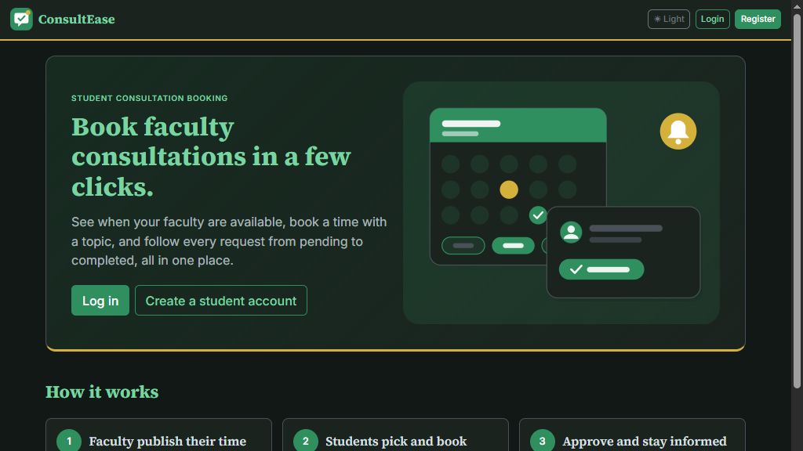
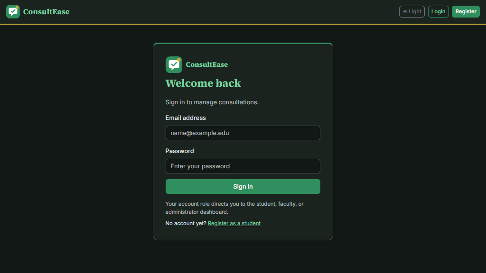
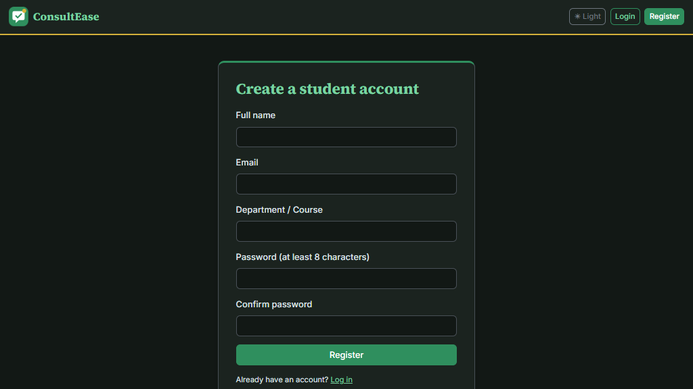

# ConsultEase

## 1. Project Title

ConsultEase: Student Consultation Booking System

## 2. Description

ConsultEase is a web-based system for scheduling student consultations with faculty. Students can find available time slots, submit a consultation topic, and follow the request status. Faculty can manage availability and review requests, while administrators manage users and view system reports. The application is built with PHP and MySQL and is currently hosted on InfinityFree.

## 3. Features

- Role-based registration and sign-in for students, faculty, and administrators
- Faculty availability management, including onsite or online meeting details
- Student search and filtering by faculty, department, and date
- Consultation requests with a topic, status tracking, and cancellation
- Faculty approval, decline, completion, and remarks
- In-system notifications for consultation updates
- Administrator dashboard, user management, reports, and CSV export
- Responsive layout with dark and light themes

## 4. Technologies

- HTML5
- CSS3
- JavaScript ES6+ (ES modules)
- Bootstrap 5
- PHP 8 (PDO)
- MySQL / MariaDB
- Fetch API (first-party PHP JSON endpoints)
- Chart.js
- Git / GitHub

## 5. Installation Instructions

### Requirements

- PHP 8 or later
- Apache
- MySQL or MariaDB
- XAMPP is recommended for local development

### Run locally

1. Install XAMPP and start Apache and MySQL.
2. Clone this repository into the XAMPP web directory:

   ```powershell
   git clone https://github.com/erinaficial/consultease-student-consultation-system.git C:\xampp\htdocs\consultease
   ```

3. In `C:\xampp\htdocs\consultease\includes`, copy `config.example.php` to `config.php`.
4. Edit `includes/config.php` with your local database settings. The example defaults are for a standard XAMPP setup. Keep `config.php` private and never commit it.
5. Follow the database setup below.
6. Open [http://localhost/consultease/public/](http://localhost/consultease/public/).

To run the focused tests from the project directory:

```powershell
node --test tests/slot-search-flow.test.mjs
C:\xampp\php\php.exe tests\meeting_details_validation.php
```

## 6. Database Setup

For a fresh local installation:

1. Open [http://localhost/phpmyadmin](http://localhost/phpmyadmin).
2. Import `database/database.sql`. It creates the `consultease` database and required tables.
3. Optional test data can be added once from the command line:

   ```powershell
   C:\xampp\php\php.exe database\seed.php
   ```

Do not import a fresh schema over a database that contains data.

For a new InfinityFree database, create the database through the hosting control panel, import `database/consultease_deploy.sql`, and put the assigned database host, name, username, and password in `includes/config.php`. Do not upload real credentials to GitHub.

## 7. Screenshots

### Landing page



### Sign-in page



### Student registration page



## 8. Live Demo

[https://consultease-ph.site.je/](https://consultease-ph.site.je/)

## 9. Developers

**Erin L. Aficial** — individual project developer.

Contributions: project planning and design, PHP/MySQL application development, front-end implementation, testing, documentation, and InfinityFree deployment.
